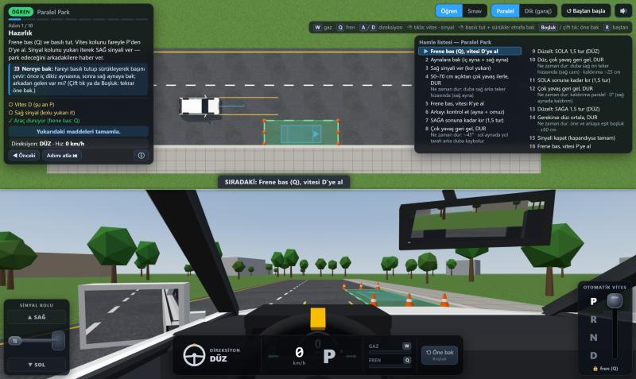
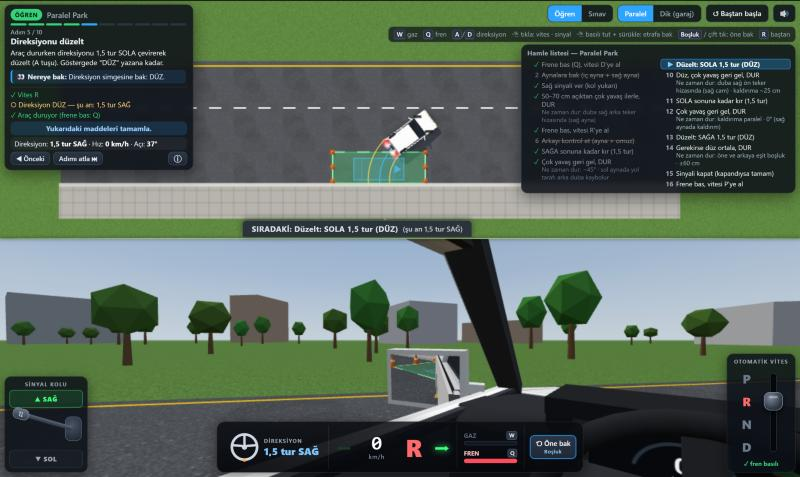
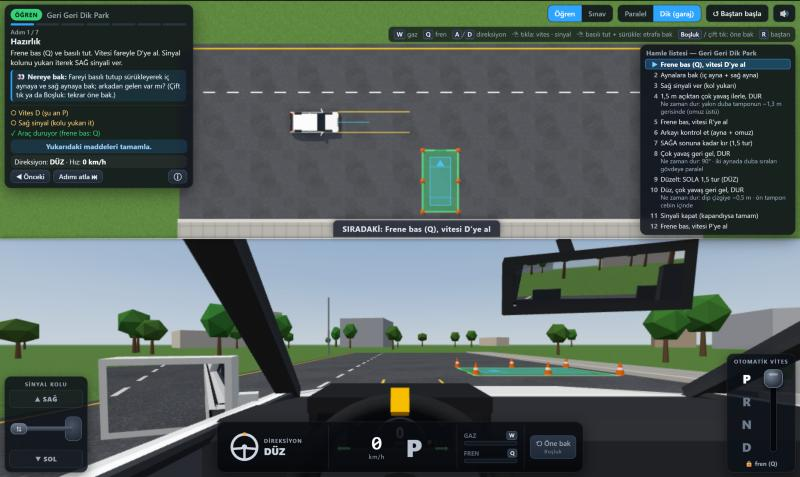

# Direksiyon Sınav Simülatörü

Ehliyet direksiyon eğitimindeki dubalı park alıştırmasını tarayıcıda, otomatik vitesli bir araçla çalışmak için 3D simülatör. Duba kuralını adım adım öğretir, sonra sınav modunda kendini denemeni sağlar.

**Canlı site:** https://betulcnl.github.io/driving_exam_simulator/

Ekranın üst yarısında aracı kuş bakışı, alt yarısında sürücü koltuğundan görürsün. İkisi aynı anda, aynı hareketle ilerler.



## Çalıştırma

En kolay yol yukarıdaki canlı siteyi açmaktır. Kendi bilgisayarında çalıştırmak için de kurulum gerekmez: `index.html` dosyasını tarayıcıda aç. three.js internetten yüklendiği için internet bağlantısı gerekir.

Yerel sunucu ile açmak istersen:

```bash
python -m http.server 5181
```

Sonra tarayıcıda `http://localhost:5181` adresine git.

## Kontroller

### Klavye

| Tuş | İşlev |
| --- | --- |
| W | Gaz. Basılı tuttukça pedal kademeli iner. Park ederken çoğu zaman gerekmez, rölanti yeter. |
| Q | Fren. Basılı tuttukça pedal kademeli iner. Kısa kısa basarak aracı çok yavaş yürütebilirsin. |
| A / D | Direksiyonu sola / sağa çevirir. Bırakınca direksiyon olduğu yerde kalır. Tam kilit 1,5 turdur. |
| Boşluk | Başı tekrar öne çevirir. |
| R | Alıştırmayı baştan başlatır. |

### Fare imleci

| İşlem | Nasıl yapılır |
| --- | --- |
| Vites (P, R, N, D) | Sağ alttaki vites kolunda harfe tıkla. Gerçek otomatik araçtaki gibi, vites değiştirirken frene (Q) basılı olmalı. |
| Sinyal | Sol alttaki sinyal kolunda SAĞ ya da SOL yazısına tıkla, tekrar tıklayınca kapanır. Kolu yukarı (sağ) ya da aşağı (sol) sürükleyerek de verebilirsin. |
| Etrafa bakmak | Alttaki sürücü görüntüsünde fareyi basılı tutup sürükle. Baş sürüklediğin yöne döner. |

İmleci basılı tutmadan gezdirmek görüntüyü değiştirmez; bu sayede vitese ve sinyale giderken etraf dönmez.

## Aynalar ve camdan bakmak

İç dikiz aynası ile sol ve sağ kapı aynaları gerçekten yansıtır: dubaları, park çizgilerini ve aracın kendi yan gövdesini aynada görürsün.

- Sol kapı aynasına bakmak için görüntüyü sola, sağ kapı aynasına bakmak için sağa sürükle.
- Daha fazla sürüklersen omuz üstünden arka yan camlardan dışarı bakarsın.
- Fareyi bırakınca bakış olduğu yerde kalır. Böylece aynaya bakarken iki elin tuşlarda olabilir.
- Öne dönmek için çift tıkla, Boşluk tuşuna bas ya da göstergelerin yanındaki "Öne bak" düğmesini kullan.



## Alıştırmalar

- **Paralel park:** sağa, geri geri. Park alanı 7,5 m x 2,5 m, köşeleri dubalarla işaretli, arkasında kaldırım var.
- **Geri geri dik park:** 3,0 m genişliğinde, 5,2 m derinliğinde cep.



## Modlar

**Öğren:** Sol panel o anki adımı anlatır ve nereye bakman gerektiğini söyler. Sağdaki hamle listesi alıştırmanın bütün hamlelerini sırayla gösterir; yaptığın hamle işaretlenir, sıradaki vurgulanır. Bakman gereken duba işaretlenir, hedef konum ve tekerlek izi yerde çizilir. Duracağın yere gelince "ŞİMDİ DUR" uyarısı çıkar.

**Sınav:** İpucu yoktur. Dubaya çarparsan ya da kaldırıma sert vurursan sınav biter. Sonunda dubaya temas, park alanının içinde olma, açı, kaldırıma mesafe, sinyal, manevra sayısı ve süre için bir değerlendirme kartı çıkar.

## Paralel parkın özeti

1. Frene bas, D'ye al, aynalara bak, sağ sinyali ver.
2. Dubalara 50-70 cm açıktan çok yavaş ilerle. Öndeki duba sağ arka tekerin hizasına gelince dur.
3. Frene bas, R'ye al, arkayı kontrol et. Direksiyonu sağa sonuna kadar kır.
4. Çok yavaş geri gel. Araç yaklaşık 45 derece olunca dur.
5. Direksiyonu düzelt. Düz geri gel, duba sağ ön tekerin hizasına gelince dur.
6. Direksiyonu sola sonuna kadar kır. Geri gel, araç kaldırıma paralel olunca dur.
7. Direksiyonu düzelt, gerekiyorsa ortala, sinyali kapat, P'ye al.

Her iki alıştırmanın tam hamle listesi simülatörde ekranın sağ üstünde yer alır.

## Araç davranışı

- Frenden ayağını çekince araç rölantide kendiliğinden yürür: ileride yaklaşık 6 km/sa, geride yaklaşık 5 km/sa.
- Park hızını gerçekteki gibi frenle ayarlarsın.
- Dönüş çapı yaklaşık 10,4 m, küçük sınıf bir hatchback ile aynı.
- Tekerlek kaldırıma değince araç durur. Dubaya değince duba devrilir.

## Notlar

- Sınav modundaki değerlendirme resmi sınav puanlaması değildir, sınava benzer bir değerlendirmedir.
- Referans noktaları (hangi dubanın hangi aynada ya da camda görüneceği) araç modeline ve koltuk ayarına göre değişir. Buradaki adımları yöntemin mantığını öğrenmek için kullan; gerçek araçta hocanın gösterdiği referansları esas al.

## Proje yapısı

| Yol | İçerik |
| --- | --- |
| `index.html`, `css/` | Sayfa ve arayüz |
| `js/config.js` | Araç ölçüleri, sürüş ayarları, alıştırma alanları |
| `js/physics.js` | Araç fiziği, çarpışmalar, park değerlendirmesi |
| `js/controls.js` | Klavye, vites, sinyal, bakış kontrolü |
| `js/lessons.js` | Öğren ve Sınav modları, hamle listesi |
| `js/world.js`, `js/carmodel.js`, `js/mirrors.js` | 3D sahne, araç modeli, aynalar |
| `js/audio.js` | Sesler |
| `dev/` | Node ile çalışan testler |

Testleri çalıştırmak için:

```bash
node dev/sim-phys-audit.js
```

```bash
node dev/sim-lessons.js
```

```bash
node dev/sim-ui-smoke.js
```
